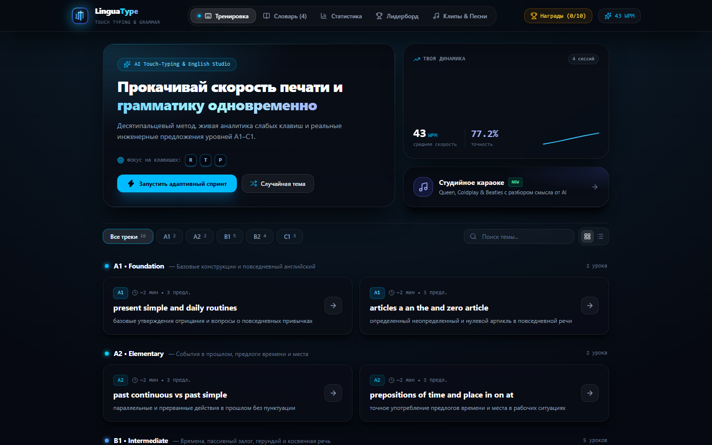
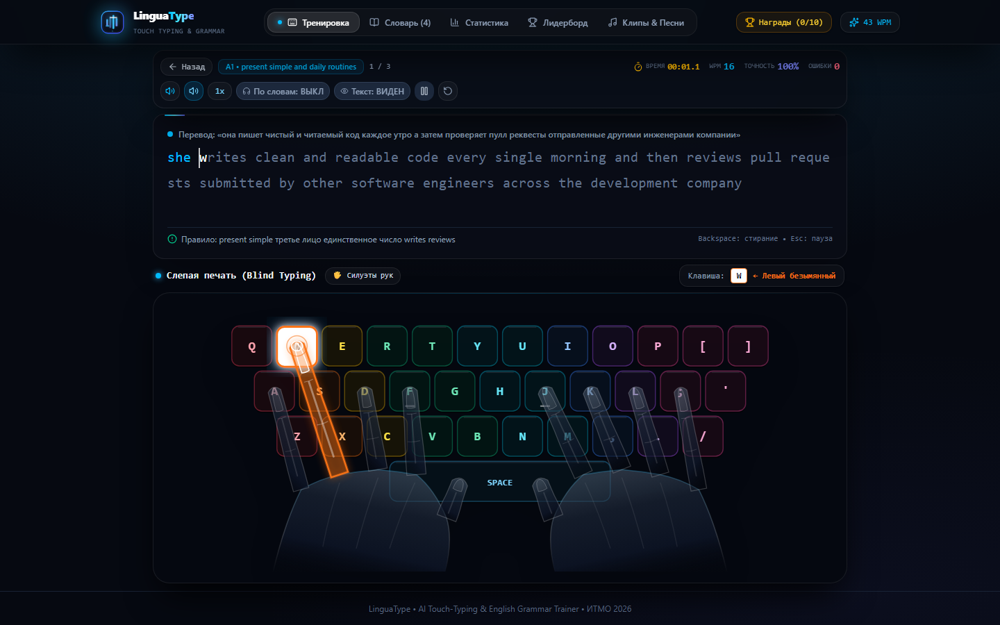
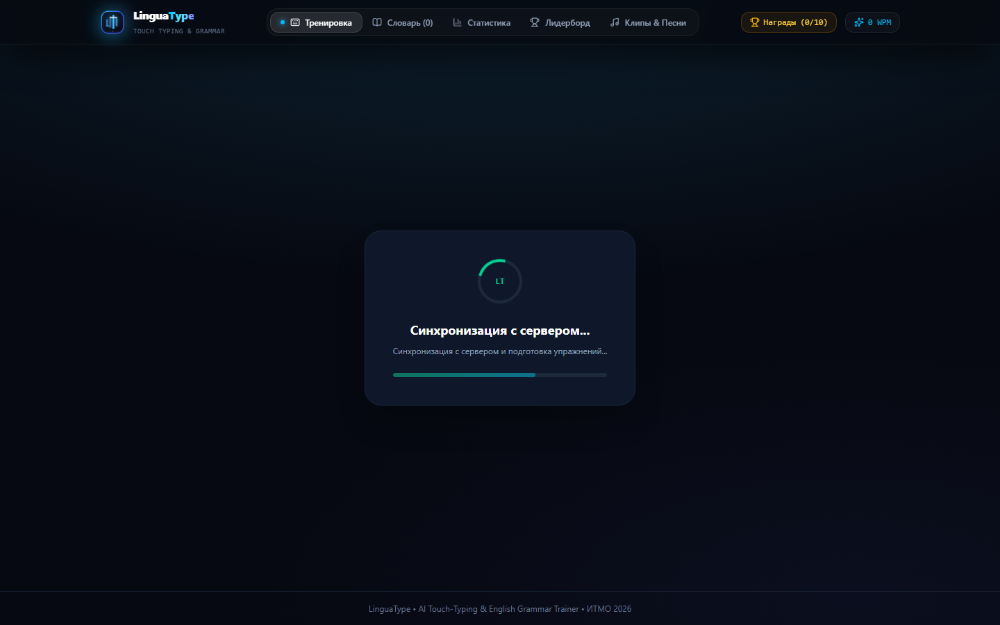
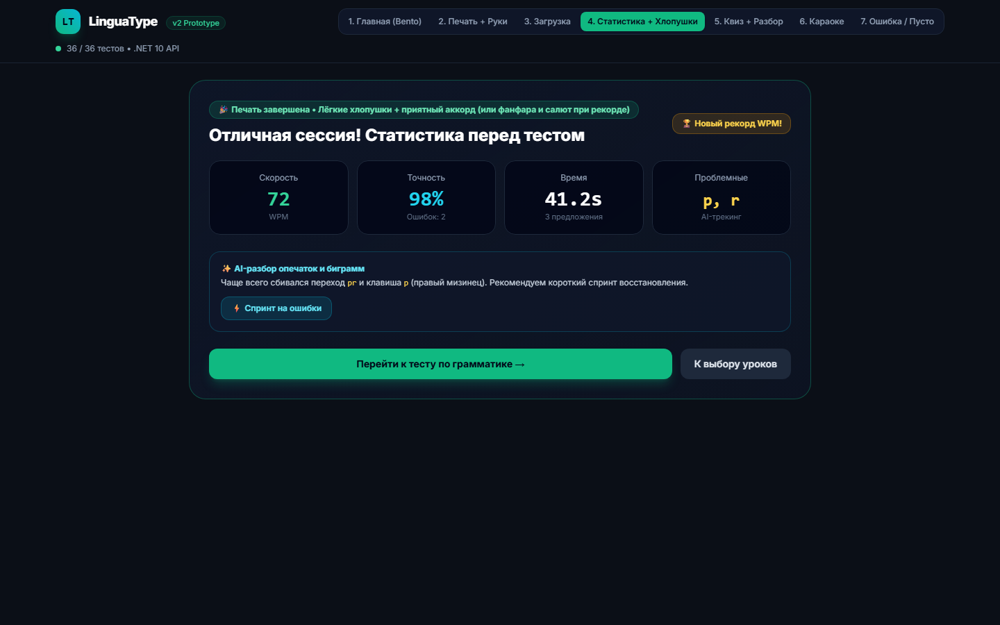
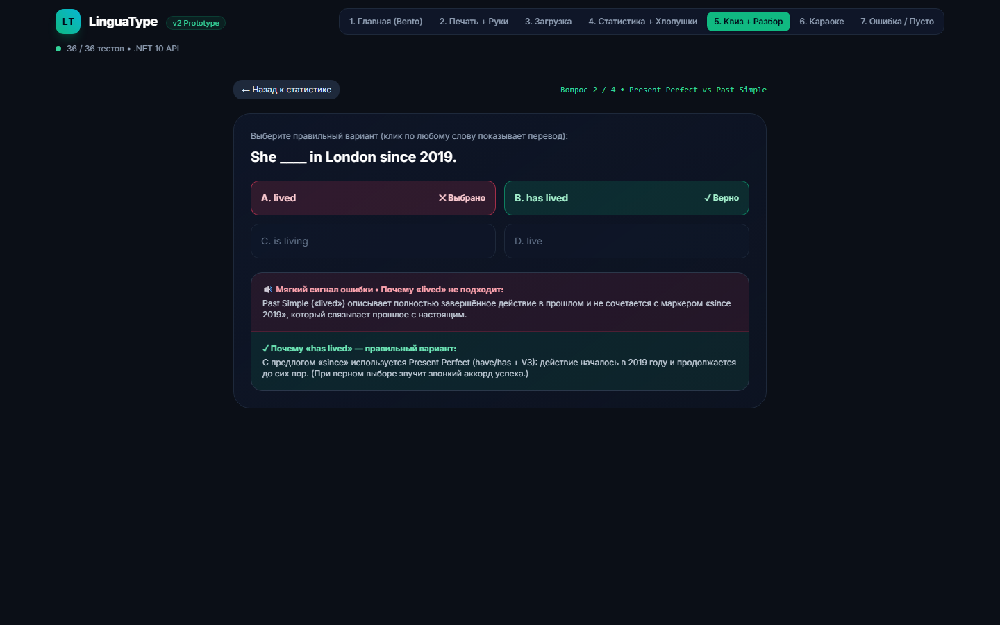
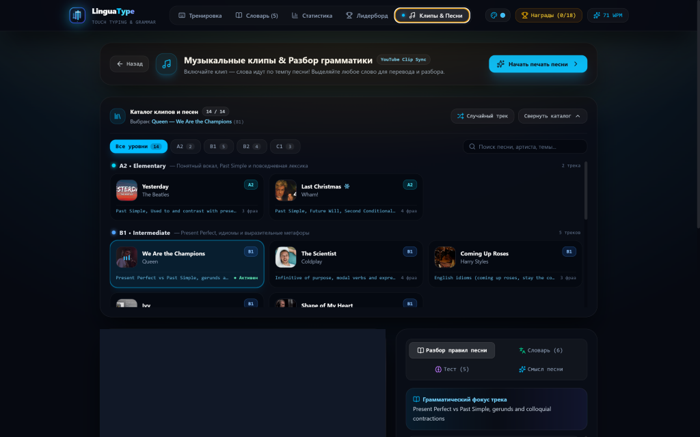
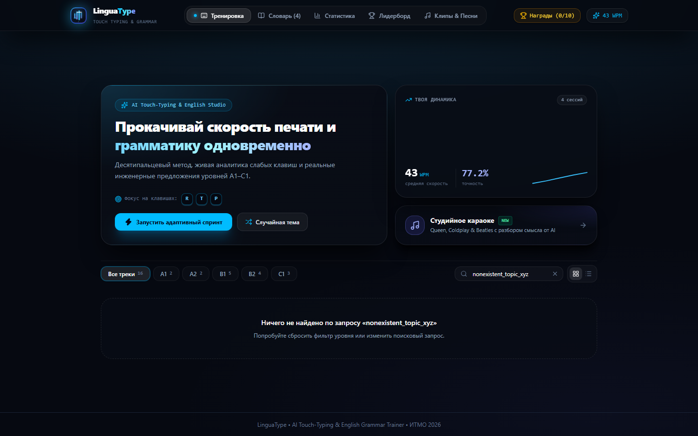
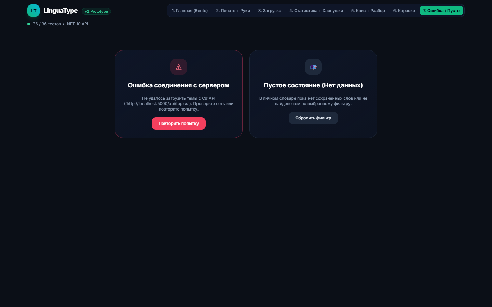

# LinguaType — AI Touch-Typing & English Grammar Trainer

> **Практика 8:** «Добавляем фронтенд к своему проекту с помощью AI» (12 из 12 баллов)  
> **Курс:** «AI-инструменты в жизни инженера: от идеи до продакшена», ИТМО 2026.

---

## 🎨 Макет интерфейса (Figma Design + FigJam)

* 👉 **[Открыть редактируемый векторный макет LinguaType v2 в Figma Design (Auto-Layout слои, карточки, кнопки, клавиатура)](https://www.figma.com/design/dYHPWWFFS32L5aauUlI8Rw)**
* 👉 **[Открыть доску пользовательского сценария (User Flow) и состояний в FigJam](https://www.figma.com/board/2rQa19fNwGGx5Grvy2Cfxc/Untitled?node-id=1009-56)**
* **Локальный интерактивный прототип всех 7 экранов и состояний (v2):** `design/mockup.html`
* **Документация промптов, вклада AI и эволюции дизайна (v1 → v2):** `design/PROMPTS_AND_AI_CONTRIBUTION.md`

---

## 📐 Spec-Driven Development (SDD / Spec-Kit)

Разработка велась строго по методологии **Spec-Driven Development** (преемственность с Практикой 5):
* 📋 **[spec-kit.config.yaml](file:///d:/3sem/vibecoding/ITMOv2/practices/practice_08/specs/spec-kit.config.yaml)** — конфигурация SDD и команд (UI & Logic).
* 🤝 **[contract.md](file:///d:/3sem/vibecoding/ITMOv2/practices/practice_08/specs/contract.md)** — согласованный контракт взаимодействия, Negotiation Log, OpenAPI 3.1 спецификация.
* 🖥️ **[ui-spec.md](file:///d:/3sem/vibecoding/ITMOv2/practices/practice_08/specs/ui-spec.md)** — спецификация компонентов, состояний интерфейса, доступности a11y и 8 зон пальцев.
* ⚙️ **[logic-spec.md](file:///d:/3sem/vibecoding/ITMOv2/practices/practice_08/specs/logic-spec.md)** — формулы WPM и точности, алгоритм трекинга слабых букв, Web Speech TTS пайплайн.

---

## 🎯 О проекте

**LinguaType** — интеллектуальный веб-сервис для одновременного развития навыков **слепой десятипальцевой печати** и закрепления **грамматических конструкций английского языка** (уровни A1–C2).

В отличие от стандартных тренажеров печати, LinguaType:
1. **Bento Command Dashboard (16 тем A1–C1):** командный центр с графиком динамики WPM, кнопкой случайной темы, группировкой по уровням CEFR и переключением «Сетка / Список».
2. **Подсвечивает зоны 8 пальцев и cyber-glass руки:** интерактивная виртуальная клавиатура с анатомическими силуэтами рук, рисками `F`/`J` и цветовым свечением активного пальца.
3. **Озвучивает правильное произношение и тактильные события:** Web Speech API (диктор) + Web Audio API (мягкий звук опечатки, приятный аккорд завершения, фанфара рекорда с хлопушками/салютами, разные звуки для верного и неверного ответа в квизе).
4. **Обучает грамматике и контексту (`Печать → Статистика → Тест`):** каждое слово в тексте, тесте и караоке кликабельно (перевод + IPA), а после статистики открывается квиз (64+ вопроса) с двойным разбором при ошибке (почему выбранный вариант неверен и почему правильный верен).
5. **Адаптируется под слабые клавиши (AI-разбор ошибок и биграмм):** фиксирует опечатки, строит тепловую карту (Heatmap) клавиатуры, график WPM и запускает спринт восстановления в один клик.
6. **Синхронизированное караоке по музыкальным клипам:** YouTube-плеер с точными LRC-таймкодами (`lrclib.net`), 60-FPS синхронизацией, разбором правил песни и AI-анализом смысла.

---

## 🛠 Технологический стек

* **Frontend:**
  * **React 19 + TypeScript + Vite**
  * **Tailwind CSS v4** + дизайн-система **shadcn/ui** (единая тема, фокусы для доступности WAI-ARIA, переиспользуемые Button, Card, Badge, Modal)
  * **Lucide React** (иконки интерфейса)
  * **Web Speech API & Web Audio API** (натуральная озвучка и тактильные звуки клика)
* **Backend:**
  * **C# / ASP.NET Core Minimal API (.NET 10)**
  * Высокопроизводительные эндпоинты: `/api/topics`, `/api/lessons`, `/api/adaptive/weak-keys`, `/api/stats`, `/api/vocabulary`
* **Клиентское тестирование:**
  * **Vitest + React Testing Library + @testing-library/user-event + JSDOM**

---

## 🚀 Быстрый старт и запуск

### Вариант А: Запуск в Docker (рекомендуемый, всё одной командой)

> Для сборки и запуска приложения и бэкенда в изолированных контейнерах без установки SDK:

```bash
cd practices/practice_08

# Запуск бэкенда (C#) и фронтенда (Nginx + React)
docker compose up --build
```
* **Веб-приложение:** `http://localhost:8080`
* **API бэкенда:** `http://localhost:5000` (проксируется автоматически)

```bash
# Запуск всех 36 тестов в изолированном Linux-контейнере:
docker compose run --rm tests
```

---

### Вариант Б: Локальный запуск без Docker

#### 1. Запуск бэкенда (C# ASP.NET Core Minimal API)
```bash
cd backend
dotnet run
```
*API будет доступно по адресу:* `http://localhost:5000`

### 2. Запуск фронтенда (React + Vite)
```bash
cd frontend
npm install
npm run dev
```
*Откройте в браузере:* `http://localhost:5173`

### 3. Запуск всех клиентских тестов
```bash
cd frontend
npm test
```

---

## 📸 Скриншоты работы интерфейса и всех состояний

| Экран / Состояние | Скриншот |
|---|---|
| **1. Главная (Bento Command Dashboard, 16 тем A1–C1)** |  |
| **2. Слепая печать + Cyber-Glass руки и 8 зон пальцев** |  |
| **3. Состояние загрузки (`Loading`)** |  |
| **4. Статистика, хлопушки и AI-разбор перед тестом (`Success`)** |  |
| **5. Квиз с двойным разбором ошибки и звуками** |  |
| **6. Караоке по музыкальным клипам (YouTube + LRC)** |  |
| **7. Пустое состояние (`Empty State`)** |  |
| **8. Состояние ошибки с `Retry` (`Error State`)** |  |

---

## 🧪 Результат запуска клиентских тестов (36 из 36 успешно)

```text
 RUN  v5.1.1 D:/3sem/vibecoding/ITMOv2/practices/practice_08/frontend

 ✓ src/tests/uiStates.test.tsx (4 tests) 236ms
 ✓ src/tests/endToEndScenario.test.tsx (1 test) 385ms
 ✓ src/tests/doubleSubmit.test.tsx (2 tests) 653ms
 ✓ src/tests/componentsAndInteractions.test.tsx (25 tests) 1171ms
 ✓ src/tests/formValidation.test.tsx (4 tests) 1483ms

 Test Files  5 passed (5)
      Tests  36 passed (36)
   Duration  5.72s
```

---

## 📋 Чек-лист соответствия критериям (12/12 баллов)

| # | Критерий | Как реализовано в проекте | Баллы |
|---|---|---|:---:|
| 1 | **Макет или прототип** | Создан редактируемый векторный макет в [Figma Design](https://www.figma.com/design/dYHPWWFFS32L5aauUlI8Rw), доска сценария в [FigJam](https://www.figma.com/board/2rQa19fNwGGx5Grvy2Cfxc/Untitled?node-id=1009-56) и локальный прототип `design/mockup.html`. Описан вклад AI в `design/PROMPTS_AND_AI_CONTRIBUTION.md`. | **3** |
| 2 | **Библиотека компонентов** | Использованы компоненты дизайн-системы shadcn/ui: `Button`, `Card`, `Badge`, `Modal` с переиспользованием токенов. | **0.5** |
| 3 | **Единое оформление** | Цвета (глубокий сланцевый `#0b0f17`, изумрудный, циан), шрифты (`JetBrains Mono`, `Inter`) и отступы унифицированы в `index.css`. | **0.5** |
| 4 | **Реальный сценарий и API** | Выбор темы в Bento-меню → слепая печать с озвучкой → статистика с хлопушками и AI-разбором → грамматический квиз → сохранение прогресса на C# бэкенде. | **1** |
| 5 | **Соответствие макету** | Готовый интерфейс 1-в-1 синхронизирован с обновлённым прототипом `design/mockup.html` (v2) и журналом итераций `design/PROMPTS_AND_AI_CONTRIBUTION.md`. | **1** |
| 6 | **Доступность (a11y)** | Поля имеют явные `<label>`, фокус виден при навигации через Tab (`focus-visible:ring-2`), всё управляется с клавиатуры. | **1** |
| 7 | **Защита от double-submit** | Кнопки и формы блокируются (`disabled={isSubmitting}`), тесты в `doubleSubmit.test.tsx` подтверждают отсутствие повторных запросов. | **1** |
| 8 | **Тесты компонентов и кликов** | Тесты `componentsAndInteractions.test.tsx`: рендер клавиатуры, 8 зон пальцев, клики карточек, открытие и закрытие диалогов и поповеров. | **1** |
| 9 | **Валидация форм** | Тесты `formValidation.test.tsx`: форма словаря проверяет обязательные поля, запрет неанглийских букв и показ ошибок. | **1** |
| 10 | **4 состояния с моками** | Тесты `uiStates.test.tsx`: проверка состояний Loading (спиннер), Empty (нет данных), Success (табло WPM), Error (баннер ошибки + Retry). | **1** |
| 11 | **Сквозной тест сценария** | Тест `endToEndScenario.test.tsx`: полный цикл от выбора темы в списке до набора символов и получения победного табло. | **1** |
| **ИТОГО** | | **Все критерии подтверждены автоматическими тестами** | **12 / 12** |

---

## 🤖 Вклад AI в разработку

* **Инструменты:** Claude 3.7 / Antigravity Agent, v0.dev.
* **Генерация макета:** AI предложил стартовую сетку и цветовую палитру в темных тонах.
* **Ручные правки и улучшения:**
  * Добавлена специализированная система цветового зонирования 8 пальцев на виртуальной клавиатуре.
  * Заменена внешняя платная озвучка на нативный Web Speech API с нулевой задержкой.
  * Реализован адаптивный трекер слабых букв и динамический расчет WPM/точности.
  * Усилена защита от double-click и покрыта строгими тестами на Testing Library.
